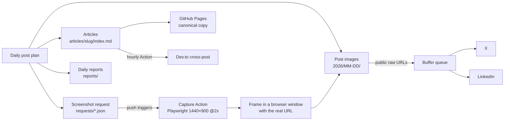

# post-media

**The media pipeline behind my X and LinkedIn posts.** Post images, auto-framed screenshots of my live products, and long-form articles, all served from one public repo and kept fresh by GitHub Actions.

[](https://github.com/minianon/post-media/actions/workflows/capture.yml)
[](https://github.com/minianon/post-media/actions/workflows/crosspost.yml)
## Why it exists

Scheduling tools like Buffer need every image at a public URL. Instead of uploading files by hand, every post's media is committed here and linked straight from `raw.githubusercontent.com`. The repo doubles as a log of everything that went out, day by day.

## How it works



1. Each day's posts are planned with their images saved under `2026/MM-DD/`.
2. Need a fresh product screenshot? A small request file goes into `requests/`. Pushing it runs the **Capture** workflow, which opens the live site in Playwright, takes a sharp 2× screenshot, frames it in a clean browser window showing the real URL, and commits it back.
3. Buffer pulls the images by their public URLs and publishes to X and LinkedIn on schedule.
4. Articles in `articles/` are published on GitHub Pages and cross-posted to Dev.to by an hourly workflow, with the canonical link pointing back here.

## Repository map

| Path | What's inside |
| --- | --- |
| `2026/MM-DD/` | Images used in that day's posts: code snippets, diagrams, product screenshots |
| `requests/` | Screenshot requests. Pushing one triggers the capture workflow |
| `capture/` | `capture.mjs` (Playwright screenshots) and `frame.py` (browser-window frame, Pillow) |
| `products.json` | Allowlist of live products that may be screenshotted |
| `articles/` | Long-form articles, rendered with `_layouts/article.html` |
| `photos/` | My own photos with `captions.json`; posted as-is, never edited or generated |
| `reports/` | Daily summaries of what was queued, plus job-alert digests |
| `.github/workflows/` | Capture, cross-post and page-check automations |
| `fonts/` | Inter, used for the screenshot frames (SIL OFL) |

## Automations

| Workflow | Trigger | What it does |
| --- | --- | --- |
| [Capture product screenshots](.github/workflows/capture.yml) | Push to `requests/**.json`, or manual | Screenshots each requested page, frames it, commits the images |
| [Cross-post articles](.github/workflows/crosspost.yml) | Every hour, or manual (with dry run) | Publishes due articles to Dev.to and records the result in `posted.json` |
| [Page check](.github/workflows/pagecheck.yml) | Manual | Confirms a published article page loads, with its title and image count |

### Request a screenshot

```json
{ "shots": [ { "url": "https://mock.minianon.in", "out": "2026/11-13/x-1500-2.png", "mobile": false } ] }
```

Only `https` URLs whose domain is listed in `products.json` are captured; anything else is skipped with a warning.

## Products featured

| Product | What it is |
| --- | --- |
| [Portfolio](https://minianon.in) | Personal portfolio |
| [Revert](https://revert.minianon.in) | Job alerts community for students and freshers |
| [ShortlistMe](https://shortlistme.site) | AI resume to portfolio website |
| [MiniLink](https://link.minianon.in) | Link-in-bio platform for developers |
| [Weaave](https://weaave.minianon.in) | Visual AI workflow builder |
| [HireLens](https://lens.minianon.in) | AI resume screening and ranking |
| [MiniMock](https://mock.minianon.in) | Chat, social and AI mockup generator |
| [MiniRizz](https://rizz.minianon.in) | AI wingman for better replies |
| [AnonBeats](https://beats.minianon.in) | Ad-free personal music player |
| [Maze Solver](https://maze.minianon.in) | Maze generator and solver with multiple algorithms |
| [Canvas Editor](https://canvas.minianon.in) | Minimal 2D canvas editor |
| [MiniVouch](https://mini-vouch.vercel.app) | Testimonial wall for developers |
| [ResumeMind](https://resumemind.vercel.app) | AI resume analyzer |

The full, current list lives in [`products.json`](products.json).

## Tech

GitHub Actions · Playwright · Python + Pillow · Node.js · Jekyll on GitHub Pages · Dev.to API · Buffer

## Author

Built by **Tushar Bhardwaj** ([Mini Anon](https://minianon.in)). Find me on [GitHub](https://github.com/minianon).

The images, photos and articles here are mine and are shared for my own posts; please don't reuse them without asking.

## Design docs

| Doc | What's inside |
|---|---|
| [High-Level Design](docs/hld.md) | Architecture, components, data flow, tech choices, deployment |
| [Low-Level Design](docs/lld.md) | Modules, data models, APIs and functions, key sequences |

