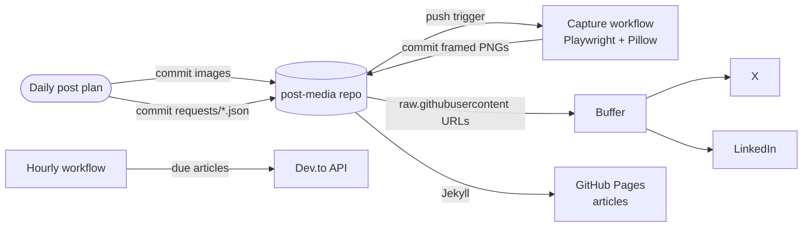

# post-media: High-Level Design

The media pipeline behind my X and LinkedIn posts: every post image is committed here and served from a public URL, live product screenshots are captured and framed automatically, and long-form articles are published on GitHub Pages and cross-posted to Dev.to. For code-level detail see the [Low-Level Design](lld.md).

## 1. System context

## 2. Components

| Component | Responsibility |
|---|---|
| `2026/MM-DD/` | Images for each day's posts |
| `requests/` + Capture workflow | Screenshot live products on demand |
| `products.json` | Allowlist of product URLs that may be captured |
| `capture/capture.mjs` | Playwright screenshots (desktop or mobile) |
| `capture/frame.py` | Wraps screenshots in a browser window showing the real URL |
| `articles/` + `_layouts/article.html` | Articles rendered by Jekyll on GitHub Pages |
| Cross-post workflow + `crosspost.mjs` | Publishes due articles to Dev.to with a canonical link back |
| `reports/` | Daily summaries of queued posts and job-alert digests |
| `photos/` | Personal photos with captions, used as-is |

## 3. Design choices

| Choice | Reason |
|---|---|
| Git repo as the media host | Buffer needs public URLs; Git gives history and a log of everything posted |
| Allowlist for screenshots | The workflow can only capture my own products |
| Canonical URL on cross-posts | Search engines credit the GitHub Pages original |
| Idempotent cross-posting (`posted.json`) | An article is never posted twice |
