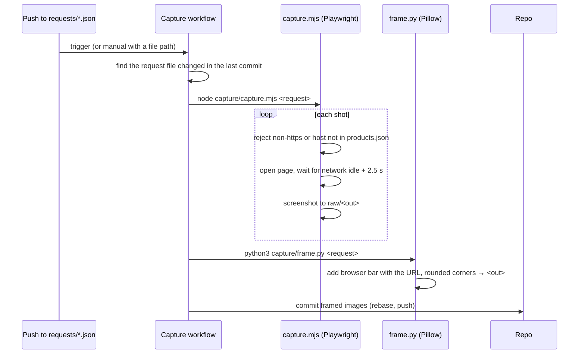
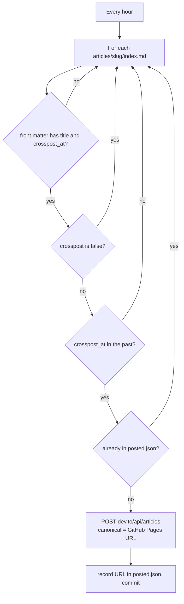

# post-media: Low-Level Design

For the big picture see the [High-Level Design](hld.md).

## 1. Screenshot request

```json
{ "shots": [ { "url": "https://mock.minianon.in", "out": "2026/11-13/x-1500-2.png", "mobile": false } ] }
```

## 2. Capture pipeline (`.github/workflows/capture.yml`)



| Setting | Desktop | Mobile |
|---|---|---|
| Viewport | 1440 × 900 | 390 × 844 |
| Scale | 2× | 2× |
| Frame corner radius | 14 px × scale | 36 px × scale |
| Browser bar height | 52 px × scale | 52 px × scale |

## 3. Cross-posting (`.github/scripts/crosspost.mjs`)



| Input | Use |
|---|---|
| Front matter | `title`, `subtitle`, `cover`, `tags` (first 4, lowercased), `crosspost_at`, `crosspost` |
| `DEVTO_API_KEY` secret | Dev.to API (skipped if missing) |
| `DRY_RUN=1` | Log what would be posted without posting |

Hashnode support is in the script but disabled.

## 4. Workflows

| Workflow | Trigger | Job |
|---|---|---|
| `capture.yml` | Push to `requests/**.json`, manual | Screenshot, frame, commit |
| `crosspost.yml` | Hourly cron (`17 * * * *`), manual | Cross-post due articles |
| `pagecheck.yml` | Manual | Fetch a published article page and report status, title and image count |
